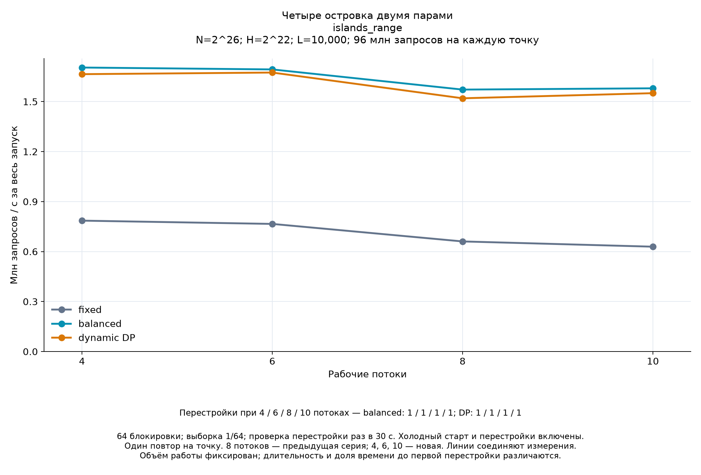

Четыре островка шириной H/16, равные доли трафика; две пары занимают два блока fixed.

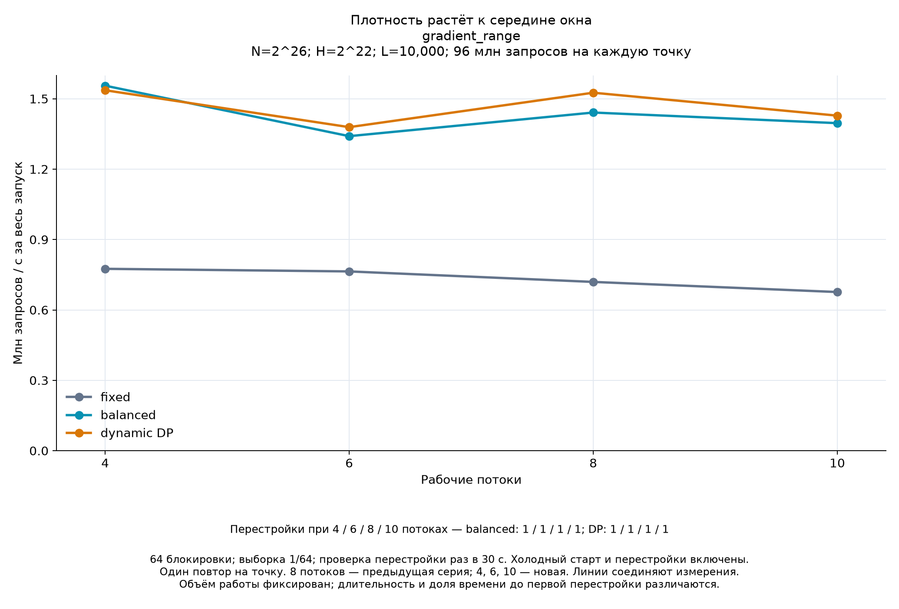

Одно окно шириной H, треугольная плотность начала диапазона с максимумом в середине.

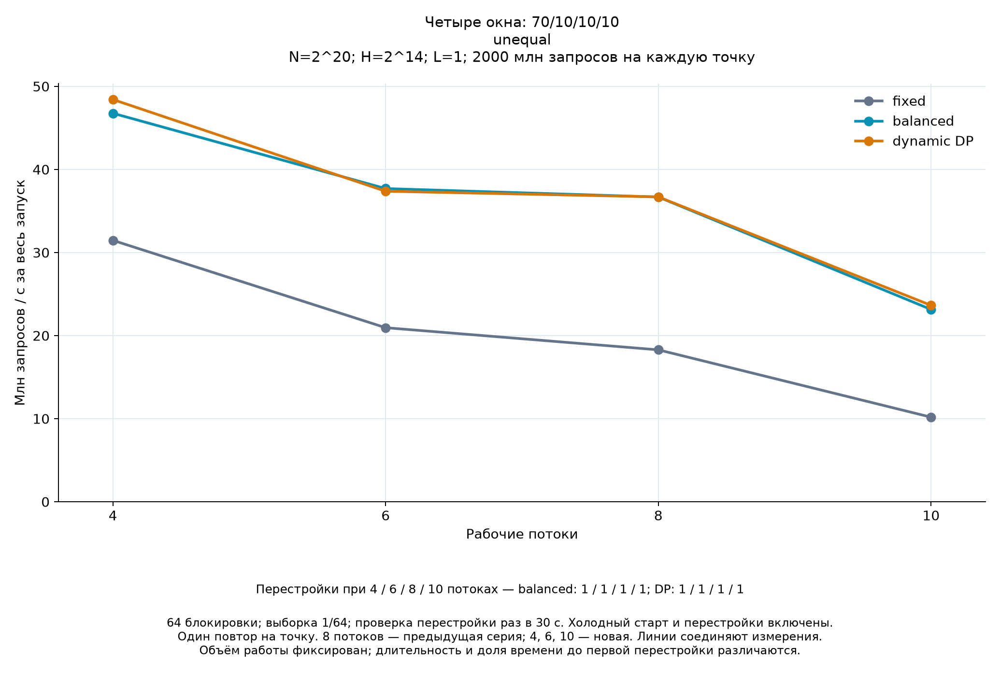

Четыре разнесённых окна шириной H, доли запросов 70/10/10/10.

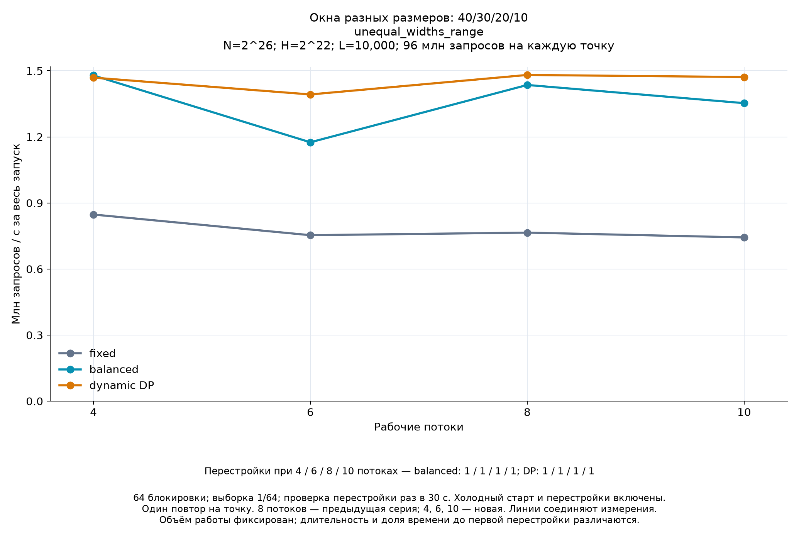

Четыре окна шириной H/8, H/4, H/2, H; доли запросов 40/30/20/10.

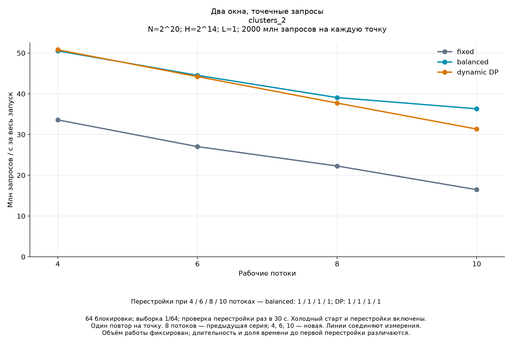

Два окна шириной H на концах массива; доли 50/50, два разных блока fixed.

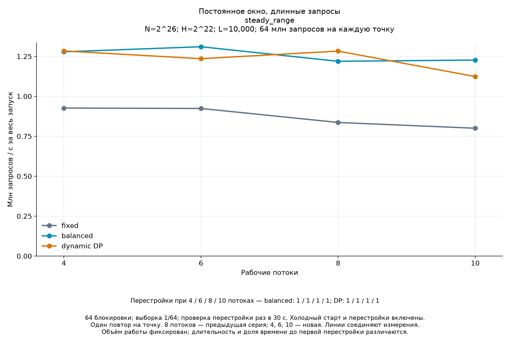

Все запросы в постоянное окно шириной H=1/16 массива, занимающее четыре блока fixed.

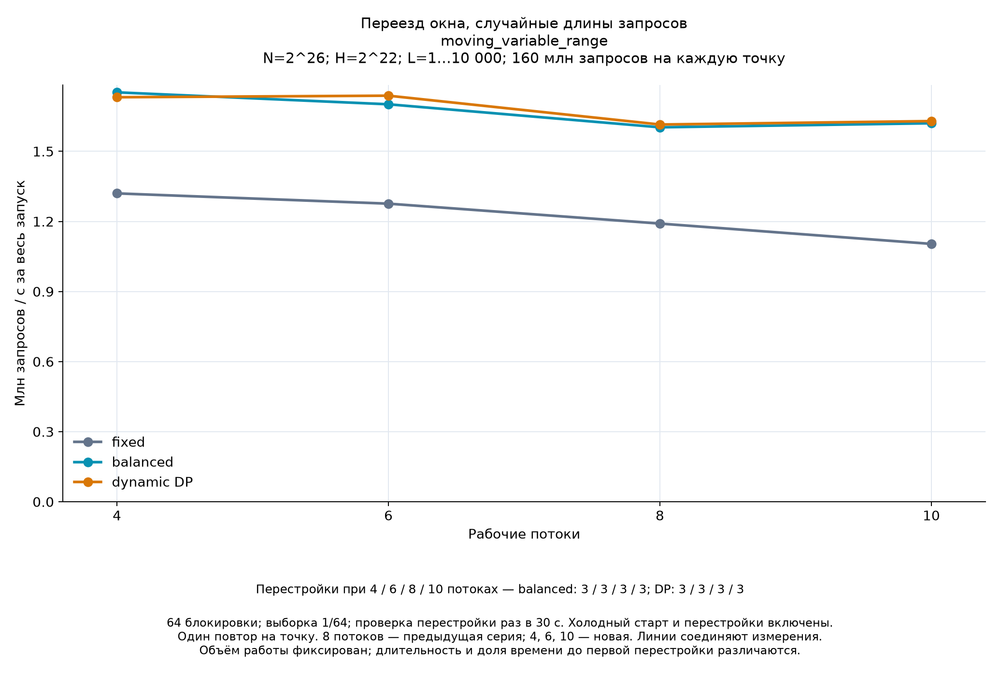

Окно шириной H переезжает слева направо после половины запросов; длина равномерно от 1 до 10 000.

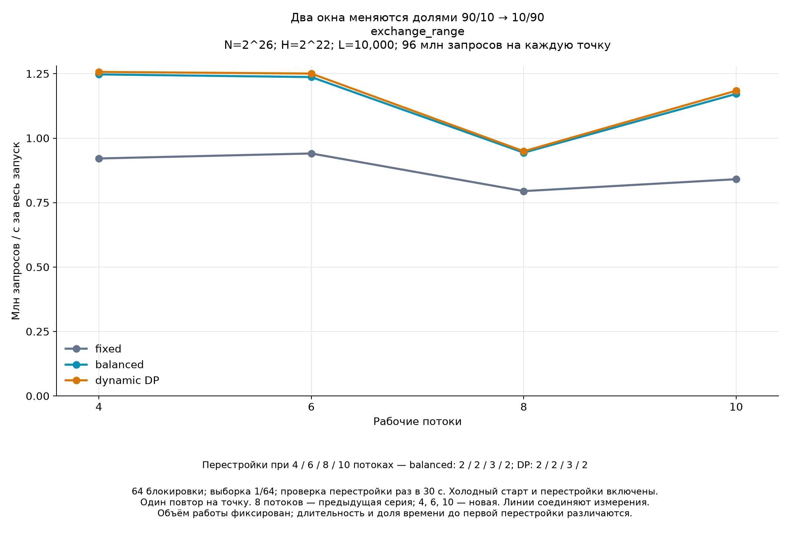

Два неподвижных окна шириной H; после половины запросов доли меняются с 90/10 на 10/90.

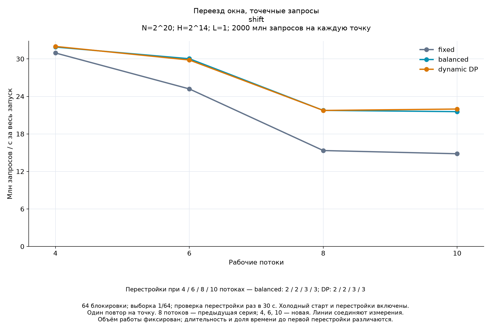

Окно шириной H переезжает слева направо после половины запросов.

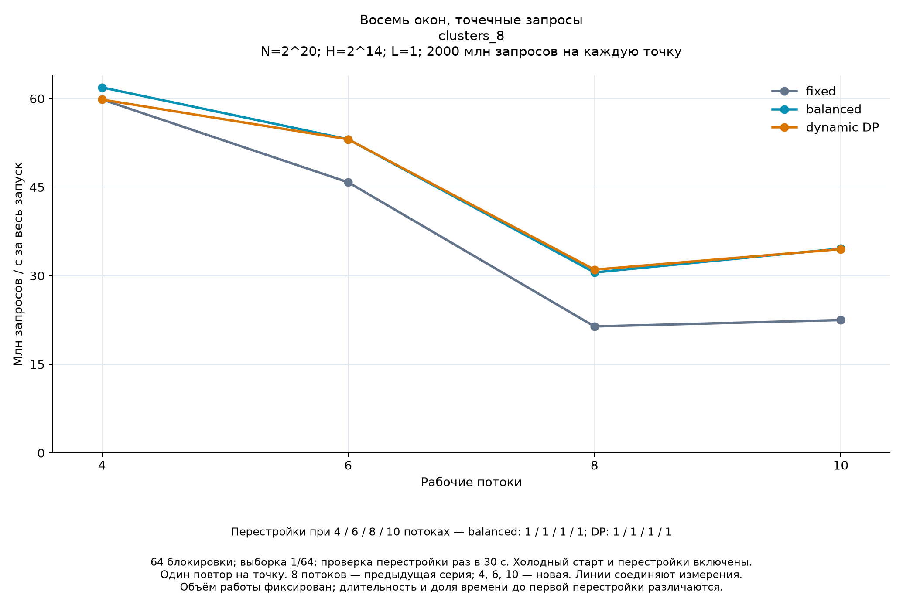

Восемь разнесённых окон шириной H, равные доли трафика; восемь разных блоков fixed.

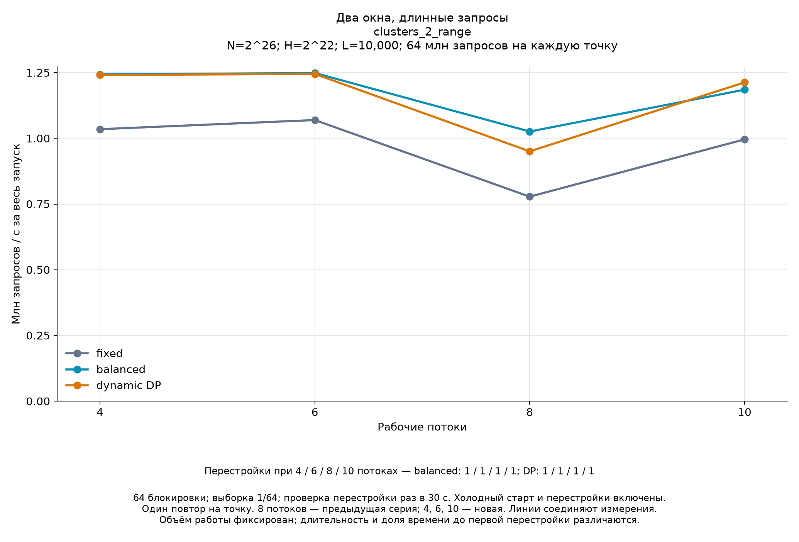

Два окна шириной H, трафик 50/50; заняты восемь блоков fixed.

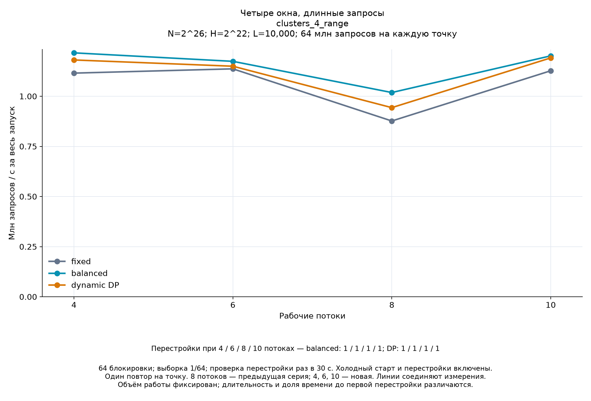

Четыре окна шириной H, равные доли трафика; заняты 16 блоков fixed.

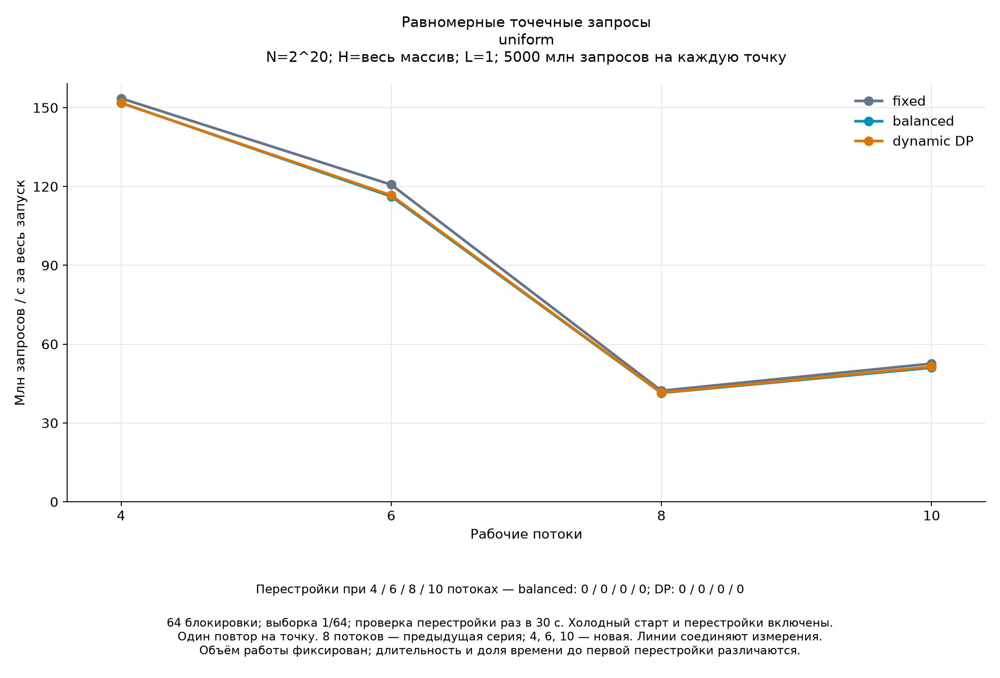

Точечные запросы равномерно по всему массиву; горячих окон нет.

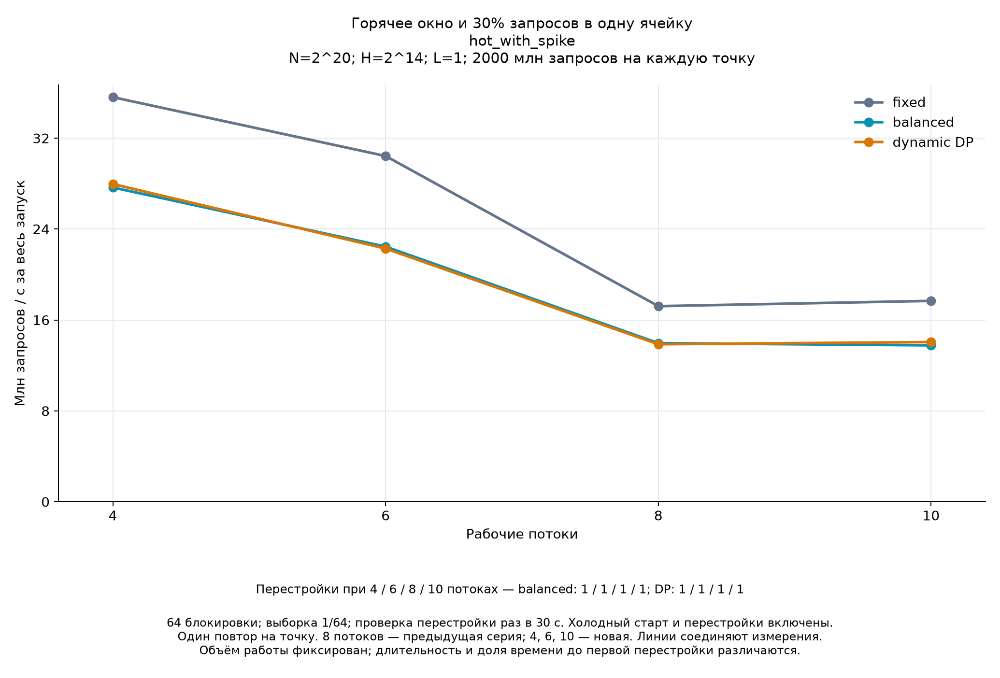

70% точечных запросов равномерно внутри окна шириной H, 30% в его центральную ячейку.
