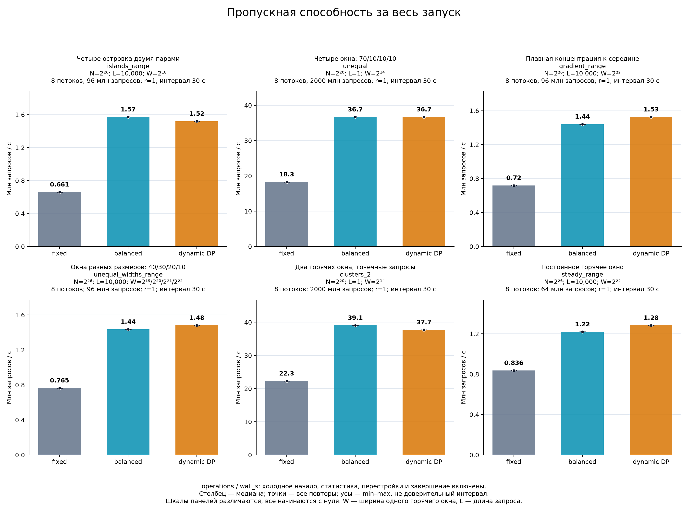

8 потоков, один повтор. Запросы/с за весь запуск, включая холодное начало и перестройки. Четыре островка двумя парами; Четыре окна: 70/10/10/10; Плавная концентрация к середине; Окна разных размеров: 40/30/20/10; Два горячих окна, точечные запросы; Постоянное горячее окно.

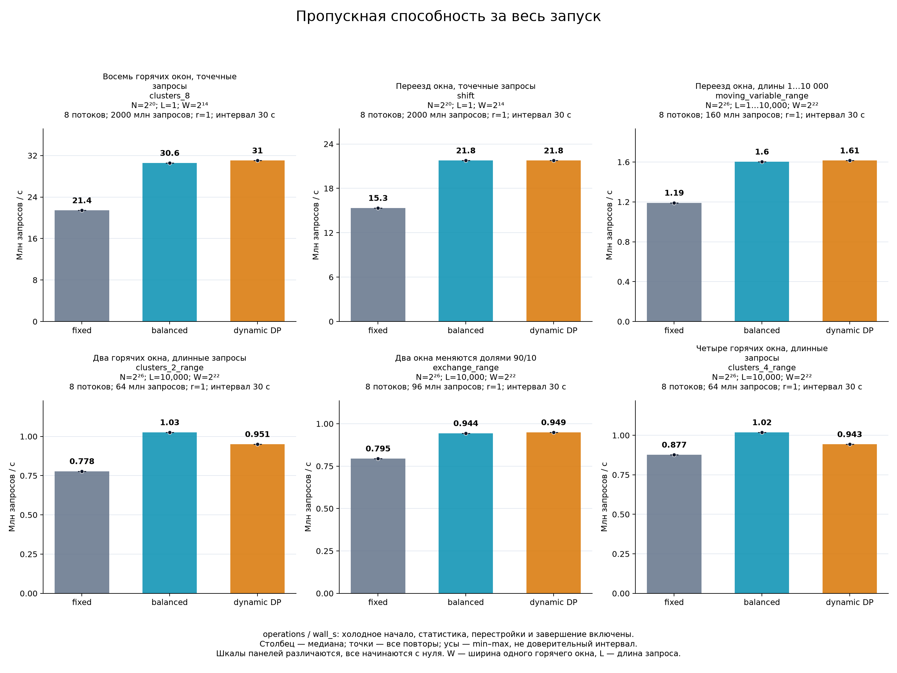

8 потоков, один повтор. Запросы/с за весь запуск, включая холодное начало и перестройки. Восемь горячих окон, точечные запросы; Переезд окна, точечные запросы; Переезд окна, длины 1…10 000; Два горячих окна, длинные запросы; Два окна меняются долями 90/10; Четыре горячих окна, длинные запросы.

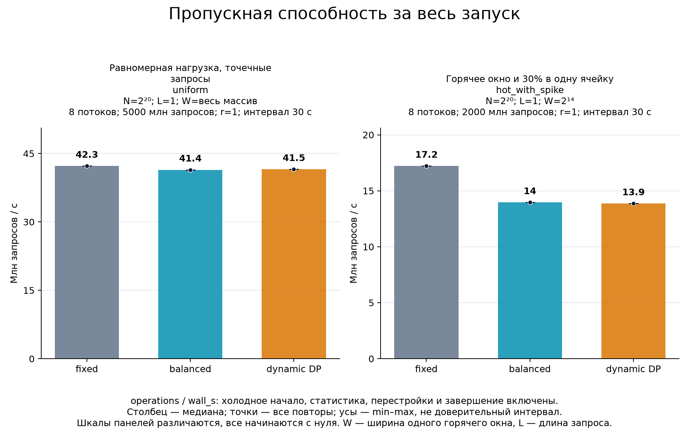

8 потоков, один повтор. Запросы/с за весь запуск, включая холодное начало и перестройки. Равномерная нагрузка, точечные запросы; Горячее окно и 30% в одну ячейку.

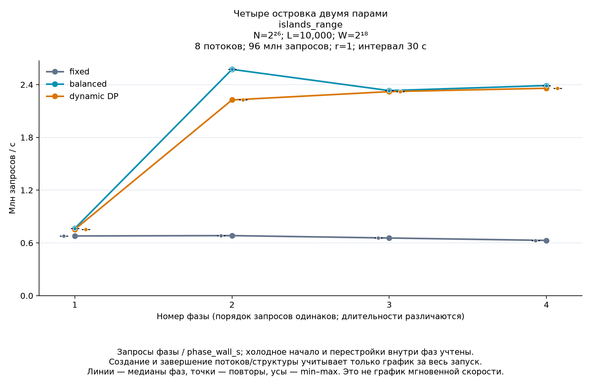

Четыре островка двумя парами. Запросы/с по фазам; длительности фаз у реализаций различаются. Это средняя скорость фазы, а не мгновенная скорость по времени.

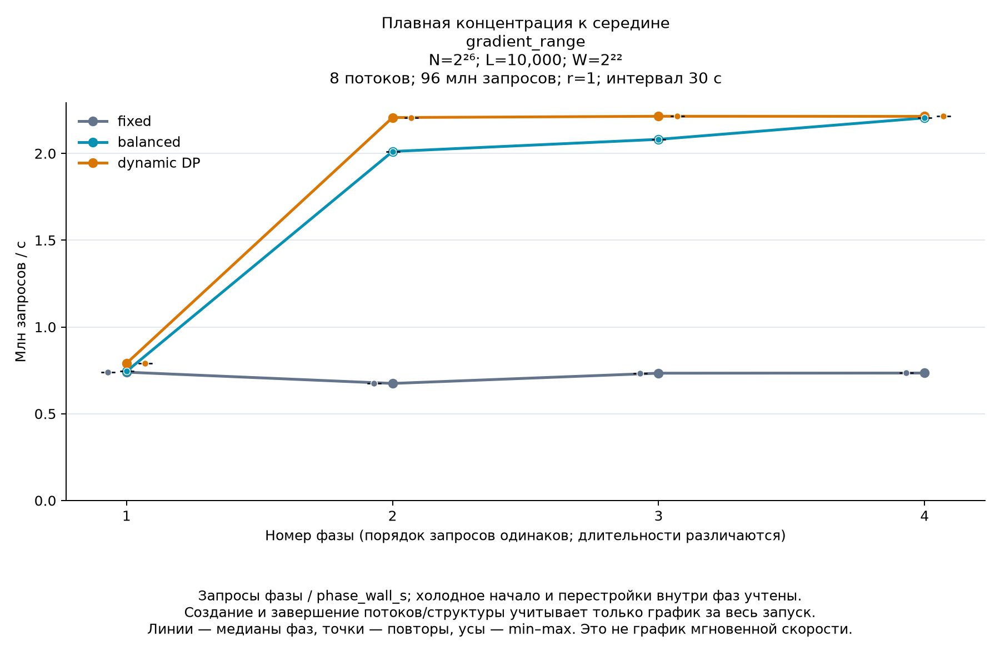

Плавная концентрация к середине. Запросы/с по фазам; длительности фаз у реализаций различаются. Это средняя скорость фазы, а не мгновенная скорость по времени.

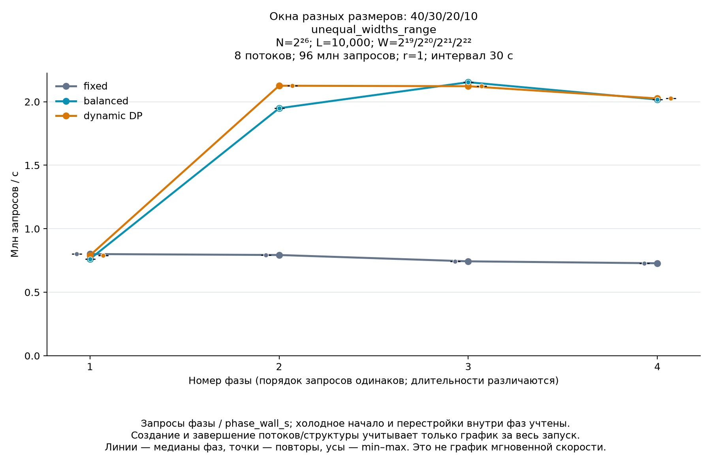

Окна разных размеров: 40/30/20/10. Запросы/с по фазам; длительности фаз у реализаций различаются. Это средняя скорость фазы, а не мгновенная скорость по времени.

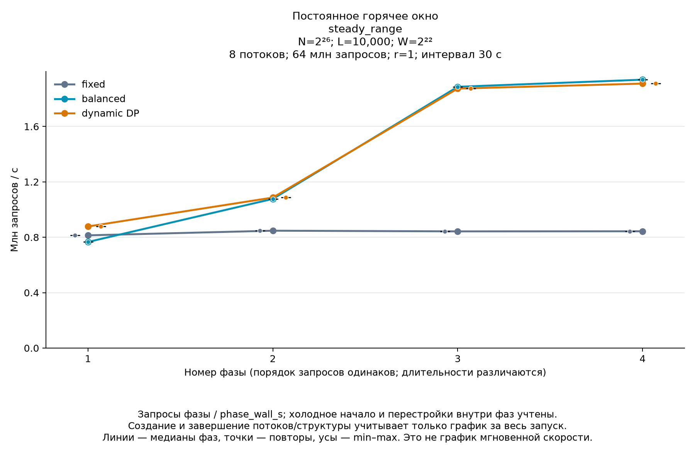

Постоянное горячее окно. Запросы/с по фазам; длительности фаз у реализаций различаются. Это средняя скорость фазы, а не мгновенная скорость по времени.

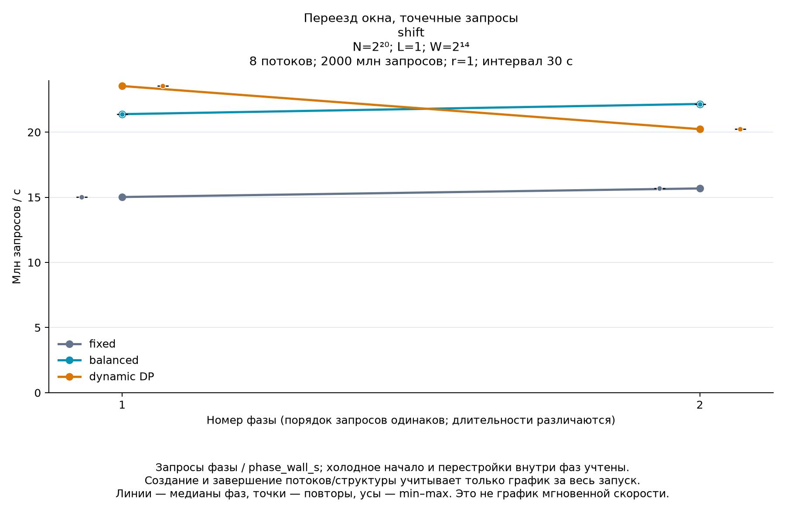

Переезд окна, точечные запросы. Запросы/с по фазам; длительности фаз у реализаций различаются. Это средняя скорость фазы, а не мгновенная скорость по времени.

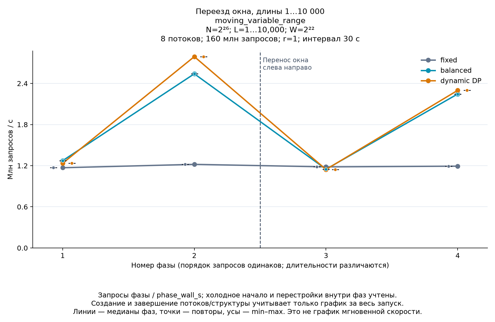

Переезд окна, длины 1…10 000. Запросы/с по фазам; длительности фаз у реализаций различаются. Это средняя скорость фазы, а не мгновенная скорость по времени.

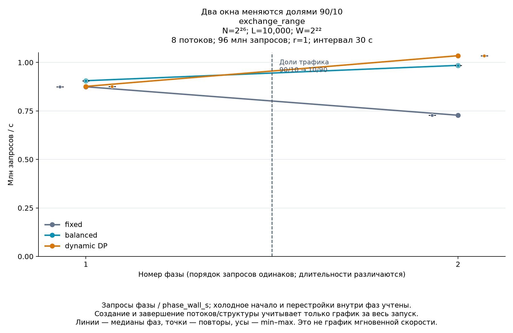

Два окна меняются долями 90/10. Запросы/с по фазам; длительности фаз у реализаций различаются. Это средняя скорость фазы, а не мгновенная скорость по времени.

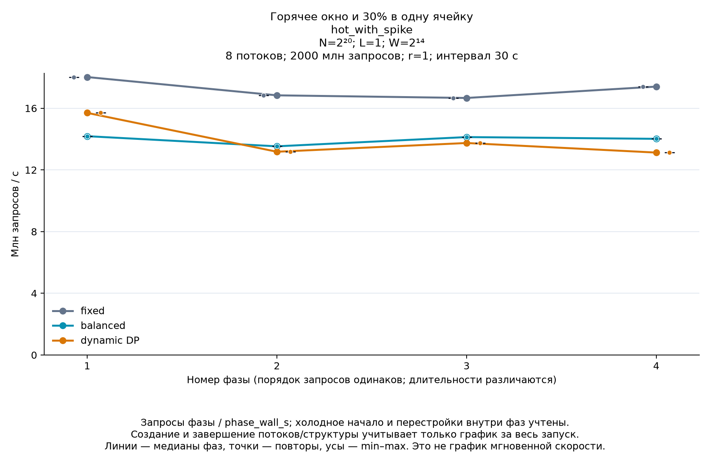

Горячее окно и 30% в одну ячейку. Запросы/с по фазам; длительности фаз у реализаций различаются. Это средняя скорость фазы, а не мгновенная скорость по времени.
