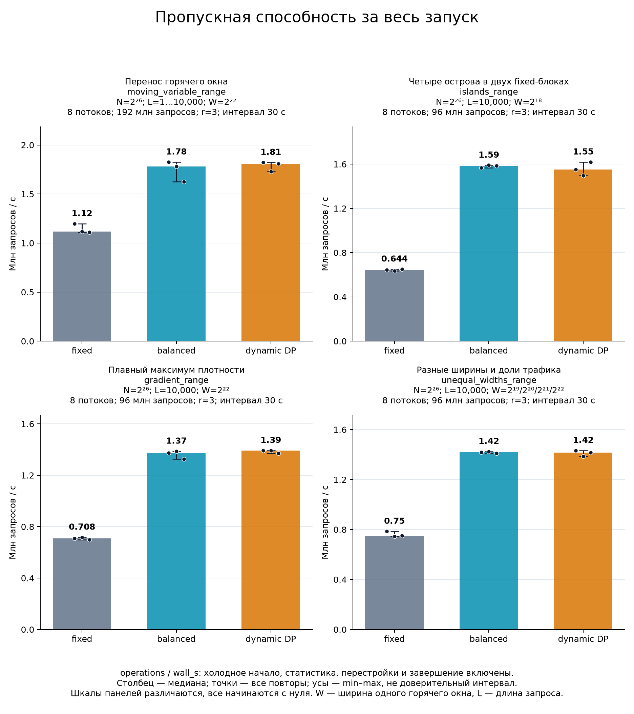
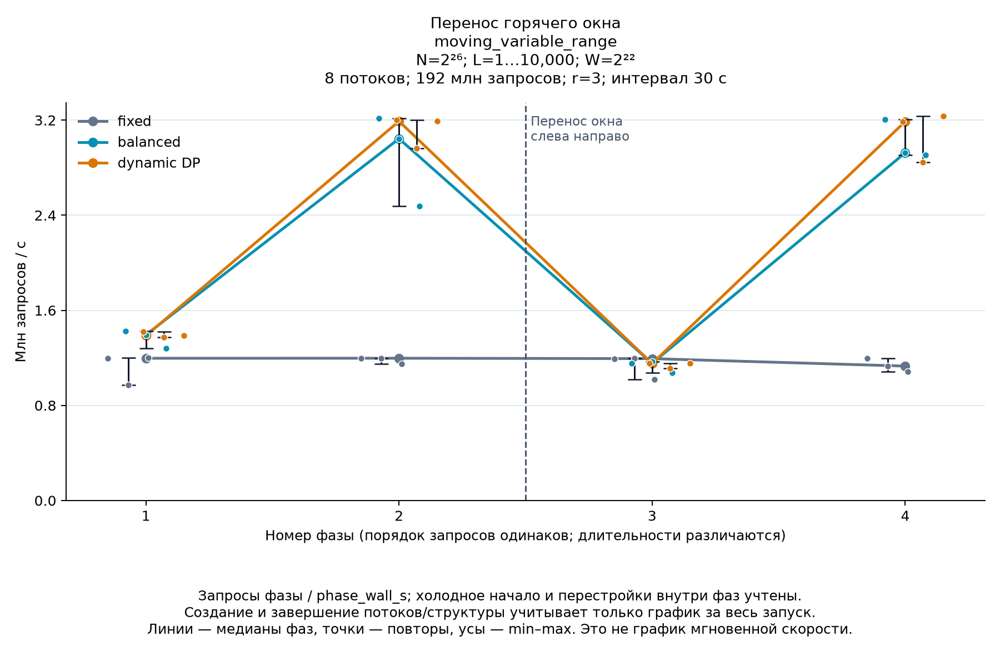
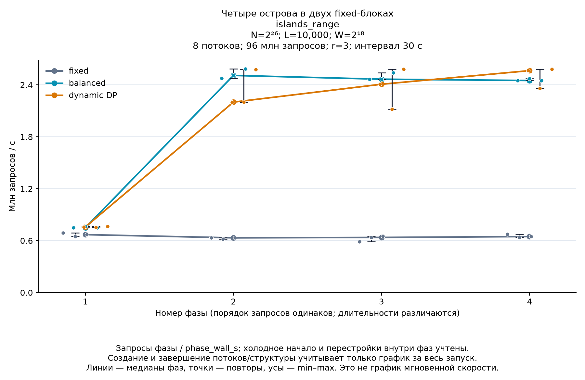
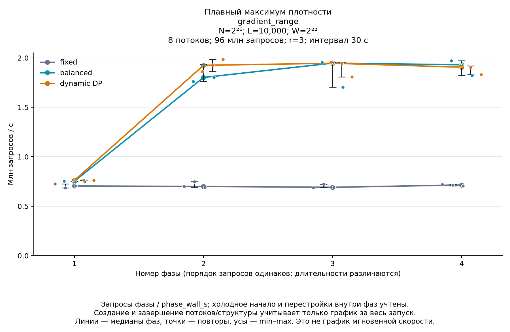
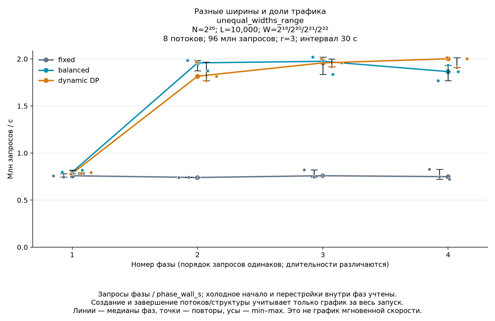
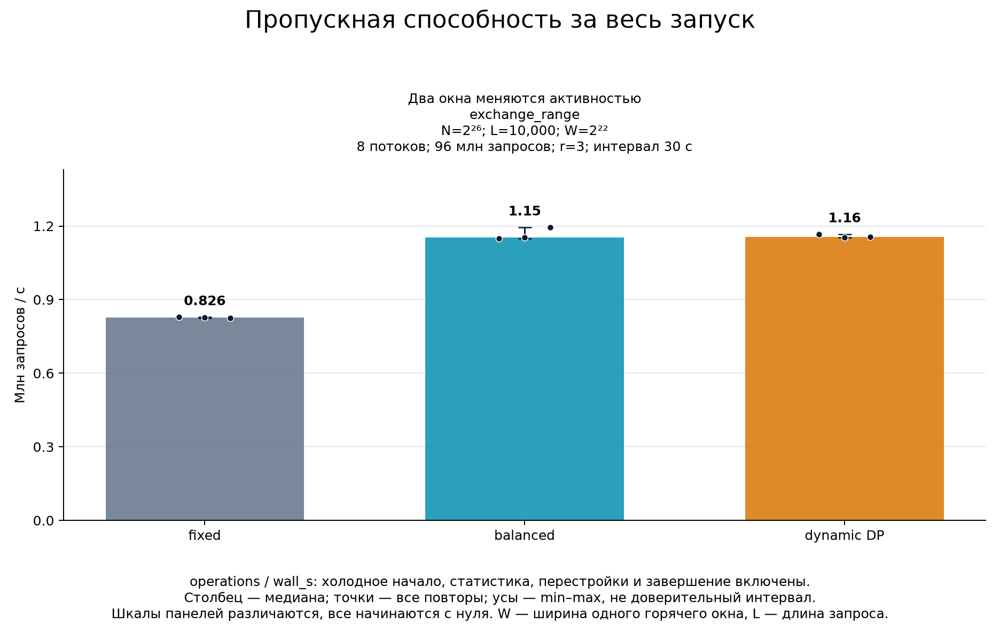
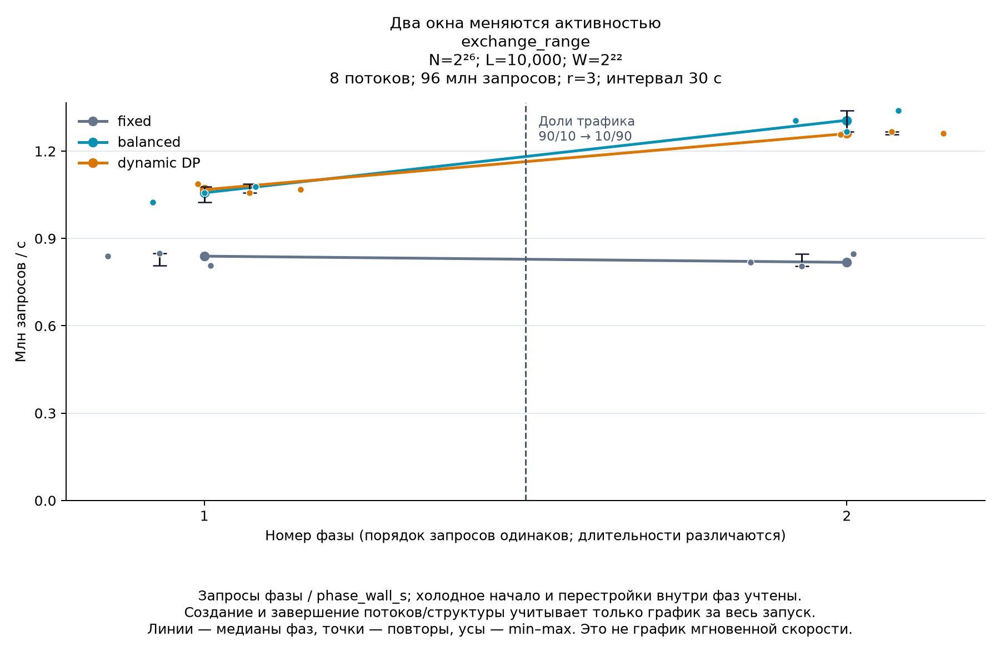

**1. Общая скорость четырёх нагрузок.** По вертикали — миллионы запросов в секунду за весь запуск, включая холодное начало и все перестройки. Серый — `fixed`, голубой — `balanced`, оранжевый — `dynamic DP`. Везде 8 рабочих потоков, интервал перестройки 30 секунд и три повтора. Точки — отдельные повторы, усы — минимум и максимум.

**2. Область, в которую стреляют все запросы, переезжает.** Массив `2^26`, окно `2^22`, случайная длина запроса от 1 до 10 000. Фазы 1–2 работают слева, фазы 3–4 — справа. Видны высокая скорость после адаптации, временный провал после переезда и восстановление. Горизонтальная ось — номер фазы, не секунды; по вертикали — средние миллионы запросов/с внутри фазы.

**3. Четыре отдельных острова внутри двух fixed-блоков.** Каждый остров содержит `2^18` элементов, длина запросов — 10 000. Фиксированная схема объединяет независимые острова под общими mutex. Распределение одинаково во всех четырёх фазах; виден эффект редкой перестройки. Оси — номер фазы и миллионы запросов/с.

**4. Плавный пик популярности.** Внутри окна `2^22` запросы длиной 10 000 чаще начинаются около центра, а к краям плотность плавно уменьшается. Геометрия не меняется между фазами. Оси — номер фазы и миллионы запросов/с.

**5. Окна разного размера с разной активностью.** Четыре раздельные области имеют размеры `2^19`, `2^20`, `2^21`, `2^22` и получают соответственно 40%, 30%, 20%, 10% запросов. Длина запроса — 10 000. Маленькое окно оказывается самым загруженным; распределение сохраняется во всех фазах. Оси — номер фазы и миллионы запросов/с.

**6. Два постоянных окна меняются активностью.** Сначала в левое и правое окна направляется 90% и 10% запросов, затем — 10% и 90%. Размер каждого окна `2^22`, длина запросов — 10 000. Столбцы показывают миллионы запросов/с за весь запуск, включая переход и обе перестройки.

**7. Тот же обмен активностью по фазам.** Фаза 1 — доли 90/10, фаза 2 — 10/90. Окна остаются на месте, меняется только популярность. Оси — номер фазы и средние миллионы запросов/с внутри неё. Перестройки внутри фаз учтены; создание и завершение структуры и потоков полностью учитываются в общих столбчатых графиках.
