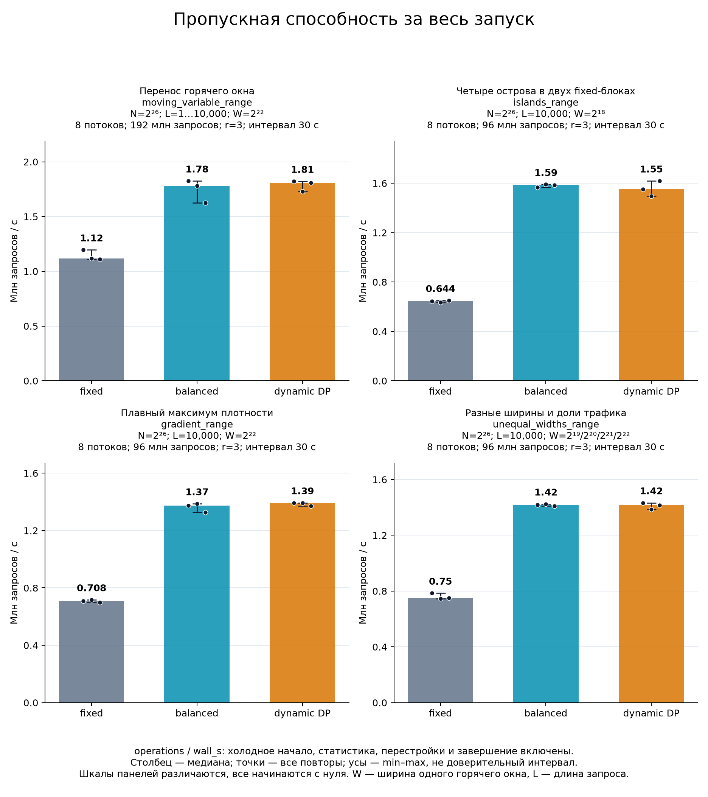
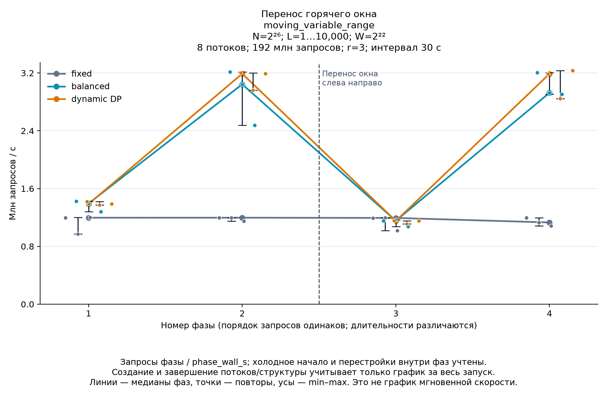
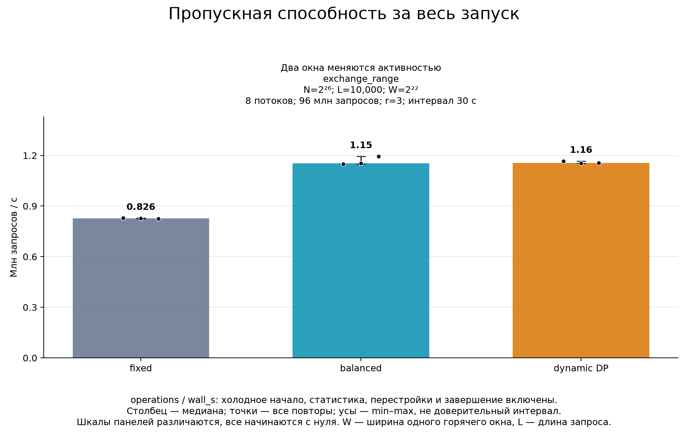

# Пропускная способность на новых нагрузках, 15 сентября 2026

Сравнение сохраняет исходные реализации `fixed`, `balanced` и `dynamic_dp`. Новые сценарии проверяют, помогает ли редкое перераспределение 64 мьютексов при неоднородной нагрузке и длинных запросах. Ни одна реализация блокировок не получает название сценария, координаты горячих окон или будущие запросы: адаптивные варианты видят только обычные обращения и накопленную статистику.

Измерения завершены отдельно от [серии 14 сентября](../BENCHMARK_RESULTS.md). Сырые CSV, журналы, параметры машины и графики сохранены в `BENCHMARK_RESULT/2026-09-15/`. Все 45 запусков подтвердили итоговый массив по эталону; алгоритмы блокировок остались прежними. Распределённые счётчики, предложенные для следующего эксперимента, здесь не применялись.

<!-- RESULTS-BEGIN -->
## Измеренные результаты

Все серии выполнены по три повтора на окончательной версии генератора. Числа ниже — медианы запросов/с; коэффициенты ускорения считаются в совпадающих повторах. Поэтому отношение медиан QPS может отличаться от медианы парных ускорений.

| Нагрузка | fixed, млн/с | balanced, млн/с | DP, млн/с | Ускорение balanced [min–max] | Ускорение DP [min–max] |
|---|---:|---:|---:|---:|---:|
| [Перенос окна, L=1…10 000](../BENCHMARK_RESULT/2026-09-15/moving_variable_range.csv) | 1.116 | 1.782 | 1.809 | 1.53× [1.47–1.60] | 1.55× [1.52–1.63] |
| [Четыре острова](../BENCHMARK_RESULT/2026-09-15/islands_range.csv) | 0.644 | 1.585 | 1.551 | 2.44× [2.43–2.51] | 2.41× [2.36–2.49] |
| [Плавный максимум плотности](../BENCHMARK_RESULT/2026-09-15/gradient_range.csv) | 0.708 | 1.375 | 1.392 | 1.93× [1.90–1.94] | 1.97× [1.94–1.97] |
| [Разные ширины и доли трафика](../BENCHMARK_RESULT/2026-09-15/unequal_widths_range.csv) | 0.750 | 1.420 | 1.417 | 1.88× [1.81–1.91] | 1.86× [1.83–1.89] |
| [Обмен долями 90/10 → 10/90](../BENCHMARK_RESULT/2026-09-15/exchange_range.csv) | 0.826 | 1.153 | 1.156 | 1.40× [1.39–1.45] | 1.40× [1.40–1.41] |

Полная длительность, CPU-время и число перестроек также сохранены; первичное сравнение использует весь `wall_s`, а не только удачные фазы. Точные команды, времена запусков и коды завершения: [runs.json](../BENCHMARK_RESULT/2026-09-15/runs.json).



[SVG основного графика](../BENCHMARK_RESULT/2026-09-15/plots/throughput_01.svg) · [Таблица QPS и разброса](../BENCHMARK_RESULT/2026-09-15/plots/summary.csv)

### Когда горячая область переезжает

В фазах 1–2 запросы направлены в левое окно, в фазах 3–4 — в правое. Каждая фаза содержит 48 млн запросов; длина выбирается равномерно от 1 до 10 000. Смена фазы задаётся выполненной работой, поэтому происходит в разное настенное время у разных реализаций. Временное падение в фазе 3 отражает работу со старым разбиением и ожидание следующей редкой перестройки.



[SVG графика переноса](../BENCHMARK_RESULT/2026-09-15/plots/phases_01_moving_variable_range.svg). Другие фазовые графики: [острова](../BENCHMARK_RESULT/2026-09-15/plots/phases_02_islands_range.png), [плавный пик](../BENCHMARK_RESULT/2026-09-15/plots/phases_03_gradient_range.png), [разные ширины](../BENCHMARK_RESULT/2026-09-15/plots/phases_04_unequal_widths_range.png).

### Когда два окна меняются активностью



[Скорость по двум фазам](../BENCHMARK_RESULT/2026-09-15/plots/exchange/phases_01_exchange_range.png) · [SVG](../BENCHMARK_RESULT/2026-09-15/plots/exchange/throughput_01.svg)

Это примеры подходящих распределений, а не гарантия выигрыша на любой нагрузке. Отрицательные результаты на равномерных и сильно конфликтующих запросах остаются в [предыдущем отчёте](../BENCHMARK_RESULTS.md).

| Нагрузка | CPU balanced/fixed, медиана | CPU DP/fixed, медиана | Перестройки balanced | Перестройки DP |
|---|---:|---:|---|---|
| Перенос окна, L=1…10 000 | 0.720 | 0.709 | 3, 3, 2 | 3, 3, 3 |
| Четыре острова | 0.465 | 0.474 | 1, 1, 1 | 1, 1, 1 |
| Плавный максимум плотности | 0.664 | 0.655 | 1, 1, 1 | 1, 1, 1 |
| Разные ширины и доли трафика | 0.664 | 0.677 | 1, 1, 1 | 1, 1, 1 |
| Обмен долями 90/10 → 10/90 | 0.839 | 0.830 | 2, 2, 2 | 2, 2, 2 |
<!-- RESULTS-END -->

## Условия

Общие параметры: массив `N = 2^26 = 67 108 864` элементов `uint64_t`, базовая ширина горячей области `W = 2^22 = 4 194 304 = N/16`, восемь рабочих потоков, 64 мьютекса, проверка перестройки каждые 30 секунд, выборка статистики в среднем одного запроса из 64. У адаптивных вариантов дополнительно работает фоновый поток. Машина — Apple M3 Pro, 11 ядер, 18 ГиБ RAM; потоки распределяет ОС без закрепления по ядрам. Компиляция — Homebrew Clang 22.1.0, Release. Подробности и контрольные суммы исходников: [metadata.json](../BENCHMARK_RESULT/2026-09-15/metadata.json).

Для каждой фазы и рабочего потока заранее создаётся независимый trace. Лимит `1 048 576` записей задаётся на одну фазу суммарно по всем потокам; после исчерпания trace повторяется циклически. В каждом из трёх повторов все реализации выполняют одинаковое число операций по одним и тем же последовательностям. Между повторами меняется seed; порядок трёх реализаций циклически переставляется.

Запрос суммирует **весь** защищённый диапазон и прибавляет случайную величину одному элементу внутри него. Все запросы используют исключительную блокировку, включая чтение диапазона. После каждого запуска весь итоговый массив сравнивается с последовательным эталоном. Это синтетические нагрузки с заданной пространственной геометрией; примеры приложений ниже объясняют их смысл и не означают измерение этих приложений.

## Нагрузки

Все интервалы окон ниже полуоткрытые `[begin, begin + width)`. Сам запрос имеет включённые концы и целиком помещается в выбранном окне. Для постоянной длины `L` допустимое начало выбирается равномерно, кроме отдельно указанного треугольного распределения. Выбор окна независим для каждой операции каждого потока.

| Сценарий | Точное распределение | Что он моделирует |
|---|---|---|
| `moving_variable_range` | Длина равномерна среди целых `1…10 000`. В фазах 1–2 окно `[0,W)`, в фазах 3–4 — `[N-W,N)`. Сначала выбирается длина, затем допустимое начало внутри окна. | Обработка диапазонов в одном разделе журнала или временных данных; после длительной работы внимание переключается на другой раздел. |
| `islands_range` | Четыре острова ширины `h = floor(W/16)`, начала `0, 2h, 8h, 10h`, доли 25/25/25/25%. Длина ровно `10 000`. | Несколько активных небольших разделов, между которыми лежат холодные данные. |
| `gradient_range` | Окно `[0,W)`, длина ровно `10 000`. Если `u,v` независимо равномерны на целых `0…W-L`, начало равно `floor((u+v)/2)`. Получается широкая треугольная плотность с максимумом в центре. | Запросы чаще обращаются к центральной части рабочего набора, а к краям интерес плавно убывает. |
| `unequal_widths_range` | Четыре окна с началами `floor(i·(N-W)/3)`, `i=0…3`, ширинами `floor(W/8), floor(W/4), floor(W/2), W` и долями 40/30/20/10%. Длина ровно `10 000`. | Разные арендаторы или разделы данных имеют разный размер рабочего набора и разную интенсивность запросов; самый маленький получает больше всего трафика. |
| `exchange_range` | Два окна `[0,W)` и `[N-W,N)`. Первая фаза направляет в них 90/10% запросов, вторая — 10/90%. Длина ровно `10 000`. | Два постоянных раздела обмениваются активностью, например при смене длительных этапов обработки. |

При выбранных `N` и `W` один fixed-мьютекс покрывает `1 048 576` элементов. В `islands_range` первые два острова делят одну такую полосу, вторые два — другую. На четыре физически раздельные области приходится всего два fixed-мьютекса: это специально проверяемый источник лишней сериализации. Внутри самих островов запросы могут пересекаться, и адаптация эти конфликты не устраняет.

В `gradient_range` и `unequal_widths_range` полезность разбиения зависит от **плотности обращений**, а не только от размеров окон. В `moving_variable_range` после переноса окна прежние границы некоторое время обслуживают новую нагрузку: ожидание следующей попытки перестройки полностью входит в измерение. В `exchange_range` оба окна остаются активными, поэтому смена распределения отличается от полного переноса единственной горячей области.

Три неизменных распределения (`islands_range`, `gradient_range`, `unequal_widths_range`) разбиты на четыре равные по числу запросов фазы с новой случайной выборкой trace, но прежней геометрией. Четыре фазы `moving_variable_range` образуют две длительные остановки: слева и справа. `exchange_range` имеет две фазы. Граница фазы не вызывает перестройку; у фонового потока свой общий период 30 секунд, который продолжает отсчитываться весь запуск.

Генератор отклоняет параметры, при которых диапазон не помещается в самое узкое окно. Для островов требуется `L ≤ floor(W/16)`, для неодинаковых окон — `L ≤ floor(W/8)` и `W ≤ floor(N/4)`, для обмена долями — `W ≤ floor(N/2)`. Диапазоны не сокращаются под сценарий. [Тест генератора](../tests/benchmark_workload_test.cpp) проверяет геометрию, доли трафика, профиль плотности, перемещение и длины; [все шесть Release-проверок прошли](../BENCHMARK_RESULT/2026-09-15/release_tests.txt).

## Что показывают графики

Главный показатель — **запросов в секунду за весь запуск**:

```text
QPS = operations / wall_s
```

В `wall_s` входят создание структуры, запуск рабочих и фонового потоков, исходное статическое разбиение до первой попытки перестройки, сбор статистики, все перестройки, ожидания, остановка потоков и уничтожение структуры. Генерация trace, предварительное обнуление массива и проверка результата исключены одинаково у всех вариантов. Предварительного обучения нет. `rebuild_ms` уже входит в `wall_s`, прибавлять его повторно нельзя.

На главном графике столбец означает медиану трёх повторов, отдельные точки показывают каждый повтор, усы — минимум и максимум, **не доверительный интервал**. Все оси QPS начинаются с нуля; масштабы разных панелей могут различаться. Сравнивать реализации следует внутри одного сценария: запрос длиной в среднем около 5000 элементов выполняет другую работу, чем запрос длиной 10 000 элементов.

Дополнительные графики показывают `число запросов фазы / phase_wall_s`. Горизонтальная ось — **номер фазы**, а не секунды: фазы содержат одинаковую долю работы, но их длительность различается между реализациями. Линия соединяет медианы фаз, точки и усы показывают повторы. В `moving_variable_range` перенос окна отмечается между фазами 2 и 3. Это позволяет сравнить последовательные части работы, но не установить точный момент перестройки или мгновенный минимум скорости.

Расходы перестроек внутри фаз входят в их время. Создание и завершение потоков и структуры полностью учитывает только главный график всего запуска; сумма времён фаз его не заменяет. Публикации новых границ дополнительно отражены в поле `rebuilds`. Одна публикация может обслуживать несколько фаз; очередная проверка статистики не обязана приводить к изменению границ.

## Воспроизведение

Нужна [Release-сборка](../README.md#сборка-и-тесты). Для основного сценария используются 192 млн запросов — по 48 млн на фазу и 96 млн на каждую остановку окна. Для трёх неизменных распределений — 96 млн запросов, по 24 млн на фазу. При средней длине 5000,5 в первом случае это примерно одинаковый суммарный объём чтения — около 960 млрд элементов на реализацию и повтор. Точное количество зависит от сохранённых случайных длин; эта нормировка не входит в формулу QPS.

```sh
mkdir -p BENCHMARK_RESULT/2026-09-15

./build/adaptive_lock_benchmark --scenario moving_variable_range \
  --threads 8 --array-size 67108864 --hot-width 4194304 --range-length 10000 \
  --operations 192000000 --trace-size 1048576 --repetitions 3 --seed 1 \
  --sample-rate 64 --rebuild-ms 30000 \
  --csv BENCHMARK_RESULT/2026-09-15/moving_variable_range.csv

for scenario in islands_range gradient_range unequal_widths_range; do
  ./build/adaptive_lock_benchmark --scenario "$scenario" \
    --threads 8 --array-size 67108864 --hot-width 4194304 --range-length 10000 \
    --operations 96000000 --trace-size 1048576 --repetitions 3 --seed 1 \
    --sample-rate 64 --rebuild-ms 30000 \
    --csv "BENCHMARK_RESULT/2026-09-15/$scenario.csv"
done
```

`exchange_range` запускается той же командой с 96 млн запросов и двумя фазами по 48 млн. Наличие сценария и прохождение проверки генератора сами по себе не являются результатом измерения производительности.

Построение графиков не требует изменения C++-сборки. Установите [зависимость matplotlib](../scripts/requirements-plot.txt) в локальное виртуальное окружение и передайте завершённые CSV в [скрипт построения](../scripts/plot_throughput.py):

```sh
python3 -m venv build/plot-venv
build/plot-venv/bin/python -m pip install -r scripts/requirements-plot.txt
build/plot-venv/bin/python scripts/plot_throughput.py \
  --input 'Перемещающееся окно=BENCHMARK_RESULT/2026-09-15/moving_variable_range.csv' \
  --output-dir BENCHMARK_RESULT/2026-09-15/plots
```

Повторите `--input 'Подпись=путь.csv'` для остальных измерений. Скрипт проверяет совпадение параметров и seed внутри каждого повтора, наличие всех трёх реализаций и `verified=true`; неполные сравнения отвергаются. Различающиеся настройки или сценарии получают отдельные панели.

Результат — общий график `throughput_01.png` и SVG той же фигуры, отдельные графики `phases_*.png`/`.svg`, а также `summary.csv` с QPS, разбросом, числом перестроек и **парными** ускорениями относительно fixed того же повтора. PNG удобен для просмотра, SVG — для вставки в презентацию без потери чёткости.
